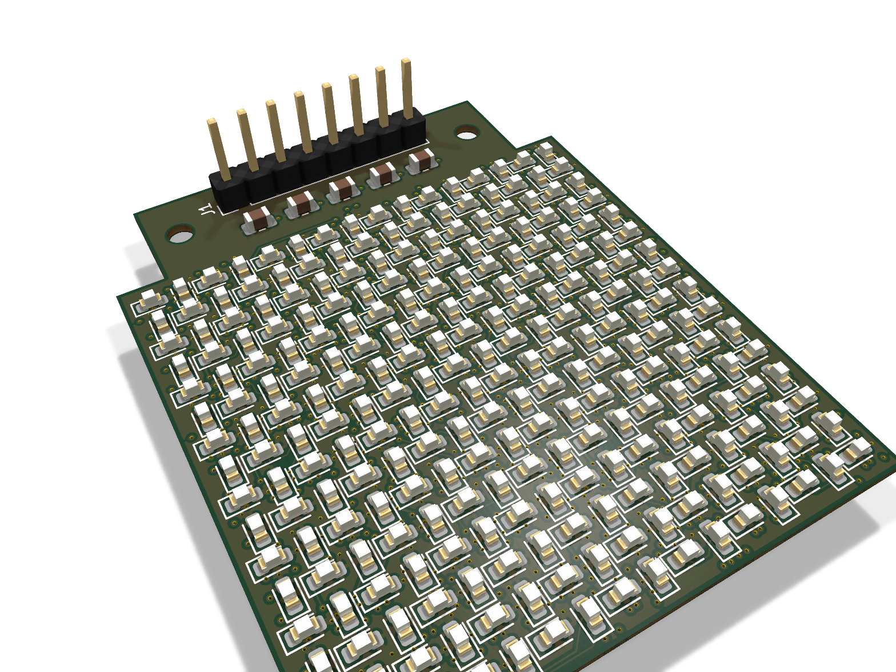
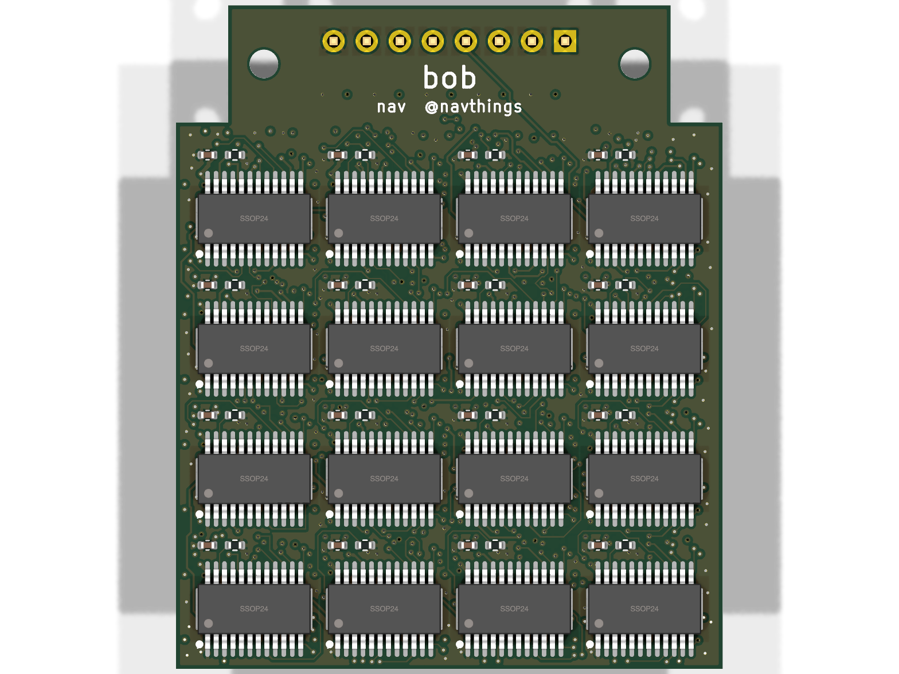
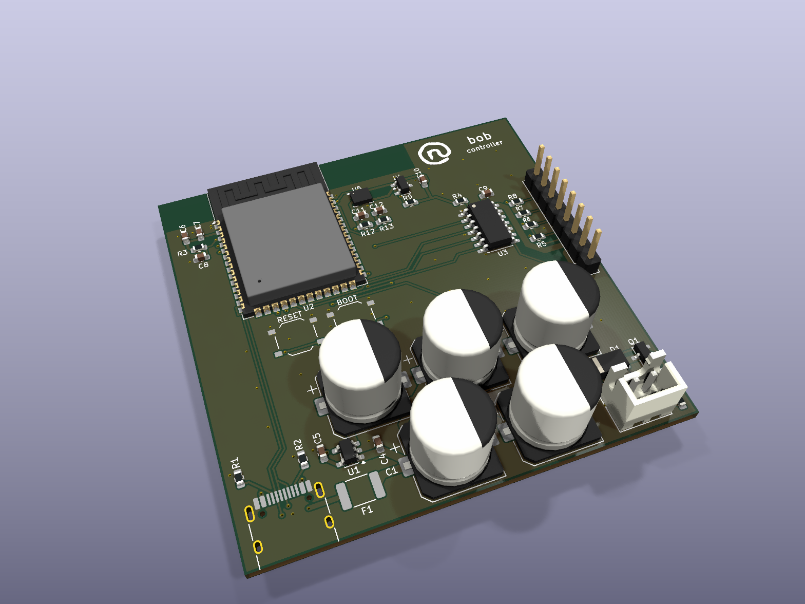
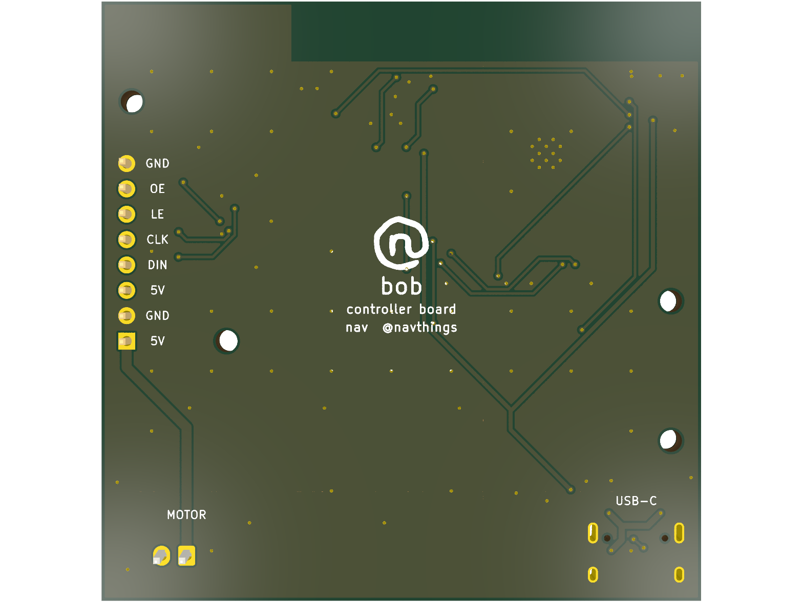
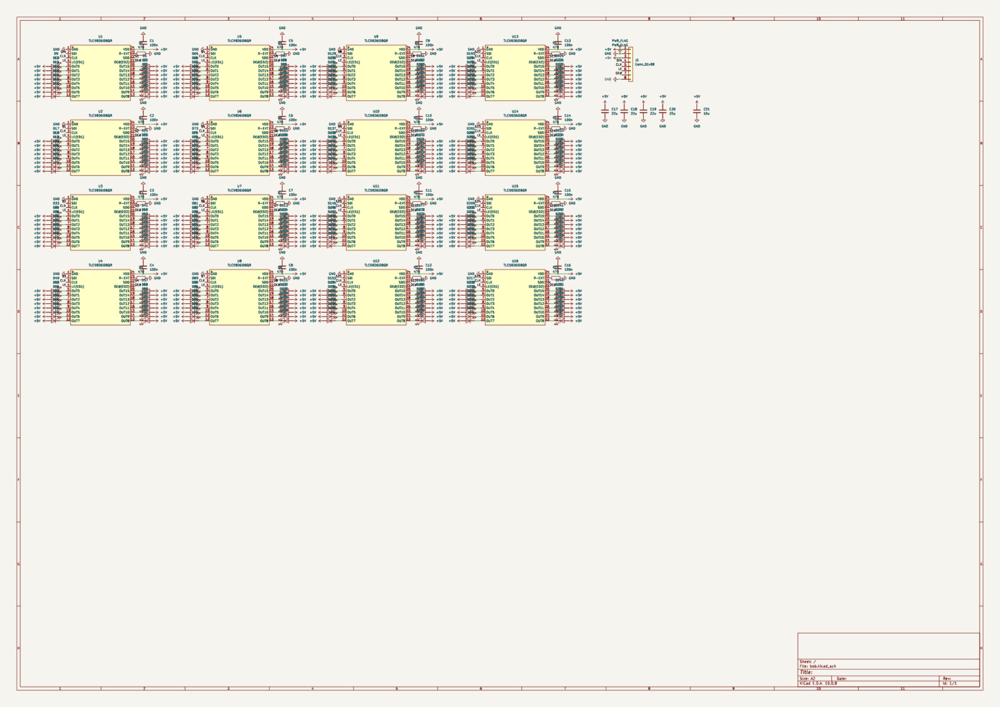
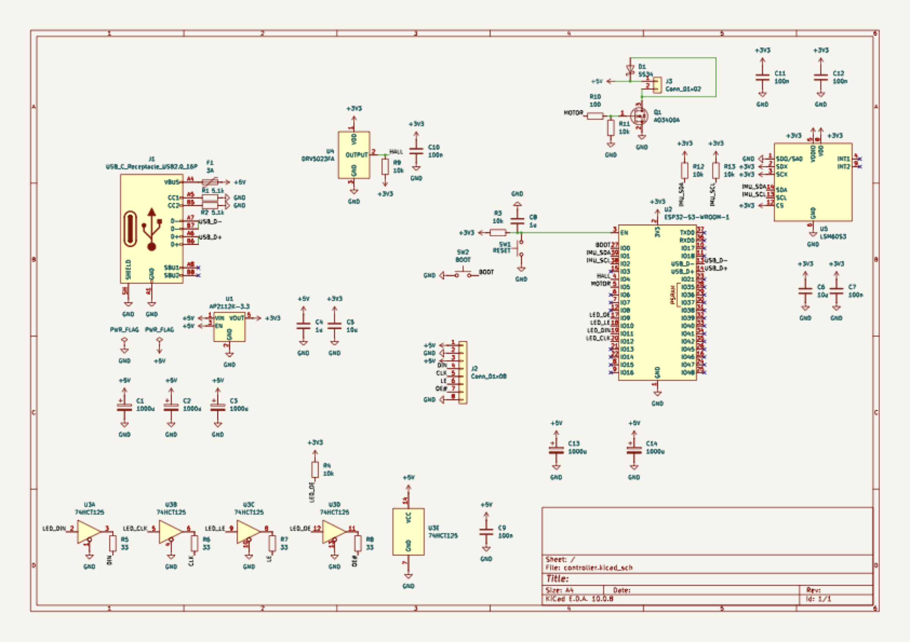

bob

i saw a video of an led grid going up and down so fast it drew a floating cube in the air and i needed one. so this is bob, a mini volumetric display

what it is

a 4cm cube of light you can see from every side. a 16x16 board of blue leds goes up and down 40mm, 20 times a second, and at every height it lights up a different slice. your eyes cant keep up so all the slices blur into one 3d shape. the plan is a water sim inside it that sloshes around when you tilt bob. building for hack club fallen

how it works

a motor spins a scotch yoke that turns the spin into straight up and down motion. a hall sensor on the controller board sees a magnet once every turn so the esp32 knows exactly where the led board is. the esp32 shifts out one 16x16 slice at a time to the 16 driver chips on the led board, 16 slices per trip. the imu on the controller says which way is down, so the water falls the right way when you tilt it

whats in here

pcb/led-board/ is the led board (kicad). 256 leds, 16 tlc5926 drivers, 4 layers, 42x51mm
pcb/controller/ is the controller board (kicad). esp32-s3, usb-c for power and code, the motor driver, hall sensor, imu and a level shifter for the led board, 60x60mm
each board has a jlc/ folder with gerbers.zip, bom.csv and cpl.csv, just upload those to jlc
bom.csv is what bob costs, both boards made and assembled at jlc (about $353 usd with shipping)
flip.py is the water sim on my mac (flip fluid), the one that goes on bob gets rewritten in c
code for bob comes when the boards do

led board

controller

schematics

